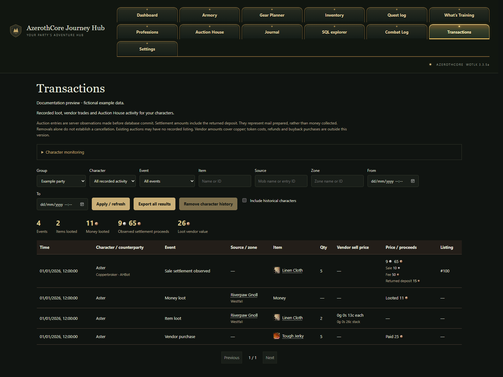
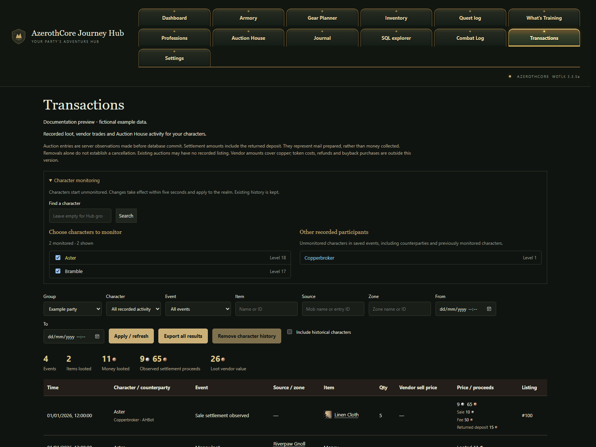

# AzerothCore Transaction Journal

A lightweight, module-only transaction recorder for AzerothCore WotLK 3.3.5a, with opt-in monitoring for players and Playerbots.

Browse the results in [AzerothCore Journey Hub](https://github.com/Daxaar/acore-journey-hub): search by character, item, source, zone or date, review coin totals, and export matching events.

## What it records

- Items looted, with creature/container identity and map, zone and area where available.
- Money looted, using each monitored party member’s actual balance increase.
- Vendor purchases and sale observations.
- Auction listings, settlement and expiry observations, including offline settlements and AHBot Plus purchases.
- Stable event IDs and listing identities for correlation and export.

Characters default to unmonitored. The Hub can change monitoring without a realm restart. Confirmed history removal affects only the module’s journal records.

## Journey Hub

Screenshots show fictional example data in Journey Hub. The Hub is a separate application.

## Getting started

See [installation and configuration](docs/INSTALLATION.md) for SQL migrations, build instructions and the shared monitoring file.

The module uses existing AzerothCore hooks. Core source changes are unnecessary.

## Current limitations

Auction and vendor-sale records are hook observations and do not guarantee database commit or later mail collection. Asynchronous inserts can be lost on a crash or database error. Generic auction removal does not prove cancellation.

Vendor token costs, refunds and buyback purchases are outside current coverage. Historical loot can have unknown sources. The journal measures received loot, so it cannot infer a drop rate from kills that awarded nothing.

## License

GPL-2.0-or-later. See [LICENSE](LICENSE).
